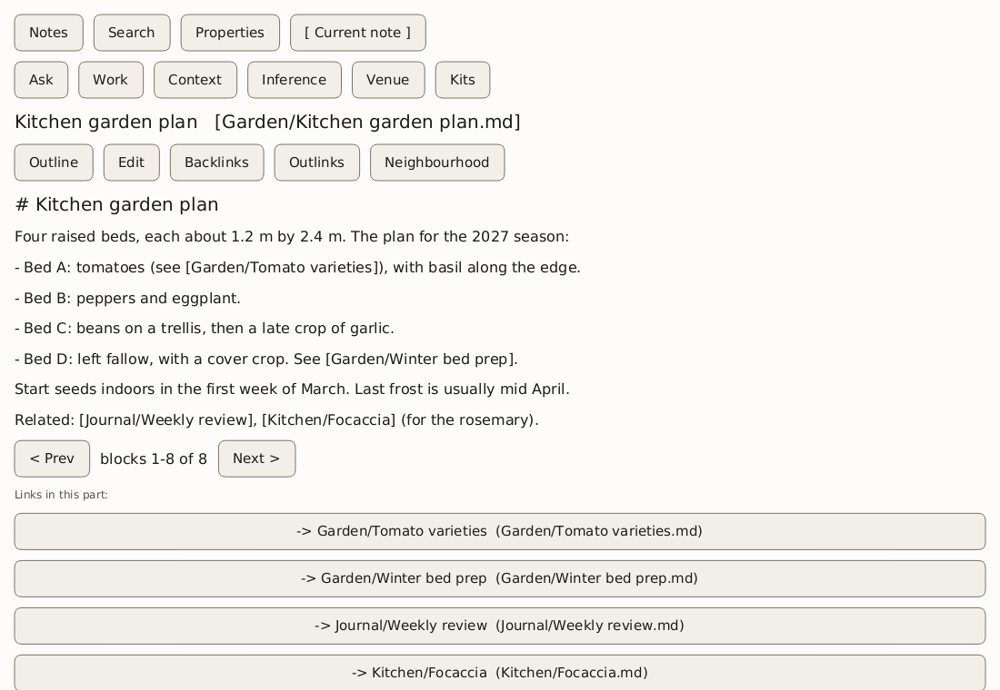
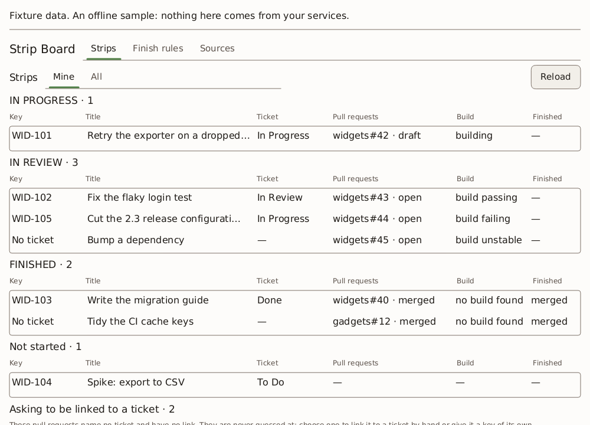
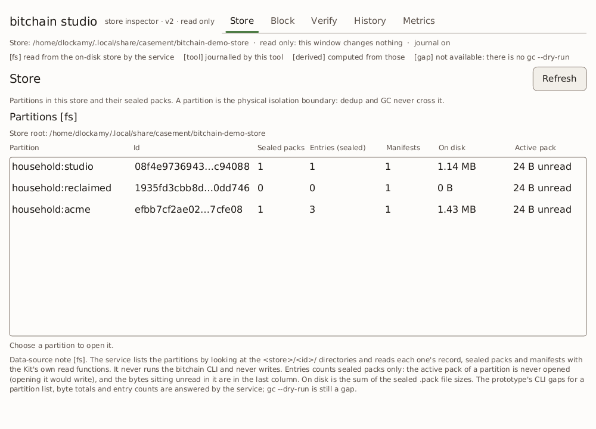
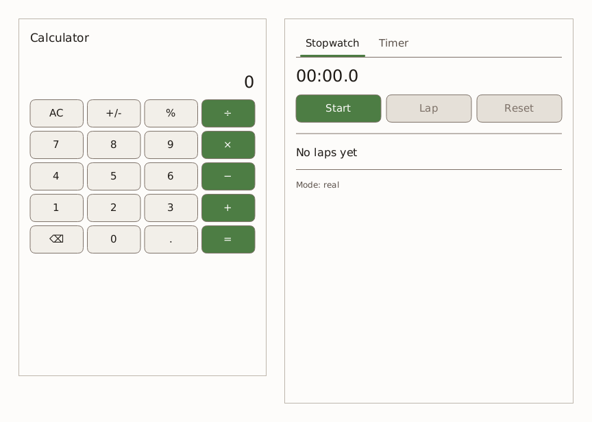

This weekend was the first time it felt like BenixOS is actually getting
somewhere. Lots of pieces have been getting built over the past few months, but
this weekend was the first round of actual, live UI work, including a taskbar
launcher for BenixOS native apps that run in their own windows.

BenixOS is a distributed operating system for your personal devices. It gives you
one way to see what you have, one way to decide where work runs, and one set of
rules about what's allowed. It's built from small libraries called Kits, and its
machines talk to each other over a protocol called Hearth.

It isn't a new Linux distribution, and it doesn't replace Docker. The earlier posts
cover [what a Kit is](/posts/2026/10/26/what-a-kit-is/),
[Hearth](/posts/2026/11/02/hearth-the-plan-9-half/) and
[four machines acting as one](/posts/2026/11/16/benixos-running-on-four-machines/).

Last week I said the first real thing I wanted running on it was a replacement for
the notes app I write in. To run any app, BenixOS needs a way to put one on a
screen, and that's what got built this weekend. It's called Casement, and this is a
short tour.

AI agents wrote the code, several at a time, and I told them what to build.

## The app doesn't draw

Casement is the program that puts apps in windows. The odd thing about it is that
an app never paints its own screen.

Take the calculator. It doesn't draw twenty buttons. It sends Casement a
description, roughly "a grid of buttons with these labels, tell me when one is
pressed". Casement picks the sizes, colours and fonts, draws it, and reports back
"button 7 was pressed". It's the same split as a web page and a browser.

That buys me a few things. An app that can't draw can't fake the window around it,
so the frame is always Casement's. The fiddly parts, focus, typing and text
editing, get written once in the shell instead of once per app.

And because the app never said how anything should look, the same app could run in
a different shell later, say one for a phone. I'm not building that one yet.

## Writing an app

An app is a small WebAssembly program, and it starts with no access to anything,
not the disk and not the network. In practice it's three pieces: some state, a
function that turns the state into a screen description, and a function that
reacts to a click or a keystroke. A small SDK covers the plumbing, and its test
harness lets you run an app with no screen at all.

Anything that needs real work, like reading notes, is done by a separate Rust
program that the app talks to over a local socket. So the app only ever describes
a screen. It never touches your files itself.

## What runs today

Casement runs on a Linux desktop, and every app gets its own ordinary window. The
launcher lives in the taskbar as a menu of apps in folders. Click one and it starts
what it needs and opens its window. Close the window and everything stops.

That's the Notes app, the one I'm replacing my own with, over some made-up notes.
There are eleven real apps so far: this one, four bigger ones, and six small demos
ported over from Flutter.

Strip Board puts a piece of work's ticket, pull request and build on one row. It's
showing sample data.

The Bitchain inspector is a read-only look inside a bitchain store. The other two
bigger ones are a machine list for Venue, the part of BenixOS that decides where
work runs, and Bozzetto, which turns a description into a 3D part.

The six demos are a calculator, a stopwatch, Minesweeper, a notepad, a render queue
and a launcher. Porting them was the real test of the framework, because each one
ran into something Casement couldn't do yet.

## What it can't do yet

- **No scrolling or rich text.** Every screen is paged or a list of buttons, and
  notes show their raw markdown.
- **No timers or per-app storage** in the spec. A stopgap app host supplies them.
- **A plain window.** It isn't the hardened mode in the design, where each app runs
  in its own sandboxed process.
- **Linux only.** The services talk over a Linux-only socket. A Mac port is
  planned and parked.
- **Private, and not pushed.** None of the new services behind these apps has had
  a security review.

Next is scrolling and rich text, then the security reviews.

The [BenixOS Book](https://book.benixos.com/) and the Hearth spec are public. If
you've built a UI toolkit and you see something I'm missing, I'd like to hear it.

Drafted with AI assistance.
