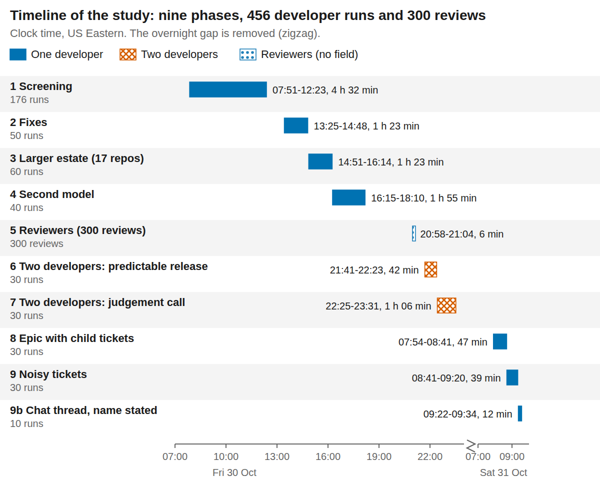
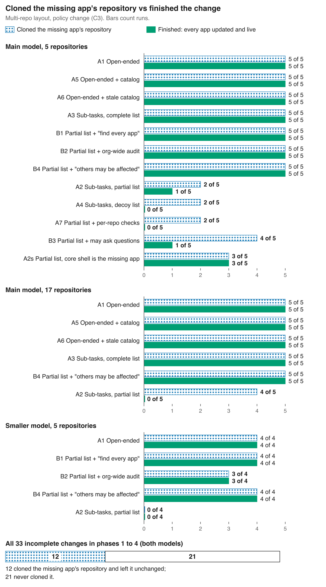

*This is the full report behind the post [Is It the Repo or the Ticket?](/posts/2026/11/09/repo-or-ticket/). The data and scripts are at [github.com/dlockamy/ticket-scope-study](https://github.com/dlockamy/ticket-scope-study). The report is licensed CC BY 4.0.*

**Status: first report.** The numbers were re-checked against the raw data on 2026-11-07 and corrected where the first draft was wrong. The author read the 12 summaries behind section 3.3 on 2026-11-09. No outside reader has read it yet, and the human review round has not been run.

**How this was done.** We designed the study with Claude (Sonnet 5.5), which built the test harness, ran the experiments unattended, and drafted this report. The developers in the experiments were also Claude agents (Sonnet 5.5 for most runs, called the main model below; a smaller model (Haiku 5.5) for a subset). Because the same system built the tests and played the developers, section 6 lists the controls and the limits.

**Scope.** One cross-repository change in a small local system, with AI agents as developers and reviewers. No people took part.

**Companions.** Prior study: [the monorepo post](/posts/2026/11/05/testing-the-monorepo-argument/). Plan: [pre-registration](https://github.com/dlockamy/ticket-scope-study/blob/main/docs/pre-registration.md). Run log (each prediction as written before its phase, with outcomes): [run log](https://github.com/dlockamy/ticket-scope-study/blob/main/docs/run-log.md). Outside sources: [survey](https://github.com/dlockamy/ticket-scope-study/blob/main/docs/outside-sources.md). Scripts and data: [https://github.com/dlockamy/ticket-scope-study](https://github.com/dlockamy/ticket-scope-study).

## Abstract

The first study varied the repository layout and held the ticket roughly fixed. This study varies both. It measures two things separately: the mechanics of a change (PRs, builds and time) and whether the change was finished (every affected app updated).

We built a small micro-frontend system twice, as one repository and as several, each with CI and CD, a package registry and real deploys. Three apps share one contract library.

AI agents played the developers, and in one phase the reviewers. A script scored each run by loading the live apps and checking every one was updated. Over nine phases: 396 single-developer runs, 60 two-developer runs and 300 reviews.

**What we found**

- **The mechanics follow the repository layout, not the ticket.** The monorepo needed 1 PR and 4 builds; the multi-repo needed 3 or 4 PRs and 12 to 16 builds. Layout explains 87% of the variance in PRs and builds.
- **Whether the change is finished follows the ticket, in the multi-repo layout only.** The monorepo never left an app out in the first four phases. In the multi-repo, a structured ticket that omitted one app left it undone in 14 of 15 policy-change runs. An open-ended ticket never did (0 of 5).
- **The cause was the agent obeying the ticket's scope.** In the first four phases, 12 of 33 incomplete changes had cloned the missing app's repository, left it unchanged, and said so. The other 21 never cloned it.
- **One sentence fixed it.** "Others may also be affected", or "find every app that uses this", took misses from 4 of 5 to 0 of 5 on the main model and from 4 of 4 to 0 of 4 on a smaller one. On the main model, token use stayed within the baseline's range.
- **What did not help.** Letting the developer ask questions (nobody did). A dependency list, even a stale one. Checks that cover only the named repositories (no better: 7 of 10 runs missed, against 4 of 10 without checks, which is not a reliable difference).
- **A reviewer catches the omission only if it can look at the repositories.** Shown the diff alone, reviewers caught 0 of 30 incomplete changes; with repository access, 27 of 30; shown the developer's note, which usually named the omission, 11.
- **Two developers finished every change, with or without a way to talk.** When the release type was a judgement call, having no channel cost six to ten extra minutes. When it was predictable, almost nothing.
- **Child tickets did not worsen misses,** and a final "verify" ticket fixed them, but agents closed 33 child tickets unopened.
- **Two kinds of messy ticket did little harm.** Terse and stale-name tickets failed in 1 of 20 runs. A chat-style ticket that never named the field failed 10 of 10; naming it fixed it.

The developers were agents; people may ask who else is affected, or act on a note saying an app was left alone. No run had a CI failure, so rework is untested.

## 1. Question, scope and hypotheses

**Question.** How much of the variation in whether a change is finished, how many PRs it takes, and how long it takes comes from the ticket and process choices, compared with the repository layout and the type of change? Which ticket practices help or harm, and in which layout?

**Starting positions, recorded before any data.**

- **A:** ticket and process quality explain as much or more of the variation in misses and rework than layout does, especially in the multi-repo setup.
- **B:** layout still dominates the deterministic measures (PRs, builds, lead time for crossing changes); process moves only misses and rework.

Both could be partly right. The study reports which outcome each holds for.

**Scope.** Process measures only: finished or not, PRs, builds, lines, turnaround, rework and tokens. Not studied: migration, retooling and staffing cost; access control; human behaviour; work-in-progress limits and queueing (single-ticket runs cannot test them); humans in any role (no human round has been run; see section 6). Reviewer input, team handoff, work breakdown and noisy tickets were added as phases 5 to 9.

**Pre-registration.** The plan listed eight predictions before the first run ([the pre-registration](https://github.com/dlockamy/ticket-scope-study/blob/main/docs/pre-registration.md)). Each later phase had its predictions written into the run log before its first round; phase 9b was added after a result and is labelled. The outside survey ([the outside-sources survey](https://github.com/dlockamy/ticket-scope-study/blob/main/docs/outside-sources.md)) was done first. A planned 12-run pilot was replaced by one pilot round (section 8).

## 2. Method

### 2.1 Environment

One Apple-silicon Mac. Docker Desktop VM with 10 CPUs and about 8 GB. Jenkins LTS with four executors, a Verdaccio private npm registry, and LocalStack for S3. All repositories local, pull requests simulated, nothing touched GitHub or any real infrastructure. Details as in [the first study](/posts/2026/11/05/testing-the-monorepo-argument/) section 2.1.

### 2.2 The system under test (the "field")

A micro-frontend demo: a core shell and two sub-route apps (billing, reports), all of which call a shared contract library (`validateApp` and a configuration object). A second library, `platform-kit`, is consumed by billing only and is in its own repository in both layouts.

| Piece | Monorepo | Multi-repo |
|---|---|---|
| The three apps | `apps/core-shell`, `apps/sub-route-billing`, `apps/sub-route-reports` | one repository each, each with CI and CD |
| Shared contract | `libs/shared-contracts`, in the same repository, inlined into each app at build time | its own repository; CD publishes a version to the private registry; apps depend on `^1.0.0` |
| Pipelines | root CI builds every app on every change; CD detects which apps changed and deploys those | per-repository CI and CD with the same stages |
| Deploy | a separate S3 bucket per layout; the deployed products are byte-identical across layouts | |

The reports app is new in this study (the first study had two consumers). The multi-repo `publish.sh` was patched to retry a lost import-map update (section 8).

**The estate (phase 3 only).** Twelve more repositories (multi-repo) or directories under `packages/` (monorepo): analytics dashboard, admin console, help center, marketing site, UI kit, logger, i18n, notifications, auth proxy, search, export service and release-notes tool. None uses the contract, and none has a Jenkins job.

### 2.3 The changes

| Code | Change | Who is affected |
|---|---|---|
| C1 | Add a configuration field and use it in billing (additive) | billing only |
| C2 | Rename a configuration field (breaking) | all three apps |
| C3 | `validateApp` must reject apps without an `owner`; each app passes its owning team, taken from its `package.json` (breaking, a policy that every app must follow) | all three apps |
| C4 (phase 7 only) | The value of `billingUrl` changes to a versioned address (same name; the release class is not obvious: patch, minor or major are all defensible) | all three apps |

C3 is the main change: finding the affected apps means asking "who calls `validateApp`?", which a search for a renamed field does not prompt.

### 2.4 Tickets

Tickets are generated from templates, not written by a model, so the text is the same across layouts apart from repository names.

| Arm | Ticket structure | What the ticket says about who is affected |
|---|---|---|
| A1 | open-ended request | nothing |
| A2 | sub-tasks per repository | lists billing and shell; **reports (the hidden app) is missing** |
| A3 | sub-tasks per repository | lists all three |
| A4 | sub-tasks per repository | lists billing, shell and **platform-kit, which does not use the contract (a decoy)**; reports missing |
| A5 | open-ended | nothing, but a dependency-catalog command lists the consumers (complete) |
| A6 | open-ended | the same catalog with reports missing (stale) |
| A7 | sub-tasks plus acceptance checks on each listed repository | lists billing and shell |
| B1 | as A2 | plus "find every app that uses `validateApp` and add a sub-task for each" |
| B2 | as A2 | plus an acceptance line and a command that scans every app repository for violations |
| B3 | as A2 | plus a command to ask the ticket writer up to three questions (scripted neutral answers that never name an app) |
| B4 | as A2 | plus "the sub-tasks below cover the apps we know about. Others may also be affected." |
| A2s | as A2 | the hidden app is core-shell instead (lists billing and reports) |
| E1 | an epic with ordered child tickets (billing, shell) | reports missing; the instruction for each app lives in its child ticket |
| E2 | an epic, children for billing, shell and reports | complete |
| E3 | as E1 | plus a last child ticket: "verify that every app that calls `validateApp` has been updated" |
| N1 | a one-paragraph ticket, no acceptance criteria | nothing; "apps pass their team (it's in package.json)" |
| N2 | a pasted chat thread of about eight messages | nothing; the requirement is buried among unrelated remarks and never states the property name |
| N2b | N2 with the property name stated | as N2 (added after seeing N2) |
| N3 | clean text | nothing; the shared library is named by an old name that no longer exists |

### 2.5 Developer agents and tooling

Each run is one fresh headless Claude session. The model is set explicitly (`claude-sonnet-5-5`, or `claude-haiku-5-5` for the second model). It has no project or user instructions, no MCP servers, and only shell, file and search tools. It gets a brief, a 25-minute cap, and one command (`st`) that stands in for GitHub and Jira: list and clone repositories, open, wait on and merge PRs, wait for deploys, record sub-tasks, mark done.

A script restores an identical snapshot of the whole field before every round and runs the monorepo and multi-repo developers at the same time, on separate repositories, buckets and jobs.

### 2.6 Scoring

Scoring is by script, never by the agent's own report. After each run the scorer loads the live deployed bundle of every app and the contract as published. For each consumer it records whether the source on `main` is updated (`src_ok`) and whether the **live bundle** runs with the new behaviour (`live_ok`). A **miss** is a consumer that is not both.

Also recorded: PRs, builds, lines changed, turnaround, rework events (CI failures, PR updates, deploy failures), repositories cloned, catalog queries, audit runs, tokens and turns.

A run counts only if the agent ran to completion without an API or authentication error. The scorer fails the unmodified baseline on every change-specific check. It detected 33 misses in the first four phases, several verified by hand against the agent's own reports.

### 2.7 Phases

| Phase | Question | Runs | When |
|---|---|---|---|
| 1 Screening | Which ticket and layout combinations produce misses? Three changes, seven ticket types, five repeats; plus a smaller-model subset | 160 + 16 | Oct 30, 07:51 to 12:23 |
| 2 Fixes | Can the structured-ticket miss be fixed? Four candidate fixes and a different hidden app | 50 | Oct 30, 13:25 to 14:49 |
| 3 Larger estate | Do open-ended tickets stay safe with 17 repositories? | 60 | Oct 30, 14:51 to 16:15 |
| 4 Second model | Do the fixes hold on a smaller model? | 40 | Oct 30, 16:15 to 18:11 |
| 5 Review | Does a second agent catch the omission? 60 saved cases (30 incomplete, 30 complete), five reviewer conditions | 300 reviews | Oct 30, 20:58 to 21:04 |
| 6 Handoff, predictable release | Two developers split one ticket; no channel, free messages, or a required handoff note | 30 runs | Oct 30, 21:41 to 22:23 |
| 7 Handoff, judgement-call release | The same, with a change whose release type is not obvious | 30 runs | Oct 30, 22:25 to 23:31 |
| 8 Epic | The same change as an epic of ordered child tickets | 30 | Oct 31, 07:54 to 08:41 |
| 9 Noisy tickets | Terse, chat-thread and out-of-date-name versions of the ticket | 30 | Oct 31, 08:41 to 09:21 |
| 9b Thread, name stated | The chat thread with the field name stated (added after phase 9) | 10 | Oct 31, 09:22 to 09:34 |

**About the token counts.** Token counts come from each agent session's usage report. They include cached input that is re-read on every turn. Output tokens were about 1% of the total in the single-developer runs.

Within each phase, rounds were ordered replicate by replicate and shuffled inside a replicate, so stopping early would have left a balanced design. Controls for phases 2 to 4 are the phase-1 cells, run hours earlier, not at the same time.

## 3. Results

### 3.1 Layout sets the cost of a crossing change

| Change | Outcome | Monorepo | Multi-repo | Difference [95% interval] |
|---|---|---|---|---|
| C1 additive | PRs | 1.0 | 2.0 | 1.0 [1.0, 1.0] |
| | builds | 4.0 | 8.0 | 4.0 |
| | turnaround, seconds | 67 | 91 | 24 [18, 30] |
| C2 rename | PRs | 1.0 | 3.9 | 2.9 [2.9, 3.0] |
| | builds | 4.0 | 15.8 | 11.8 [11.4, 12.0] |
| | turnaround, seconds | 66 | 138 | 72 [63, 81] |
| C3 policy | PRs | 1.0 | 3.6 | 2.6 [2.4, 2.8] |
| | builds | 4.0 | 14.4 | 10.4 [9.7, 11.1] |
| | turnaround, seconds | 72 | 135 | 64 [51, 78] |

(Phase 1, main model, all arms pooled.) A sequential decomposition of the variance gives layout 87% of the variance in PRs, 87% in builds and 60% in turnaround; the ticket arm gives 1% of each. The multi-repo cost comes from the ordering constraint: the library must be published before an app can adopt it. This confirms the first study. It did not depend on the ticket.

### 3.2 Whether the change is complete depends on the ticket, in the multi-repo layout only

Runs with at least one app not updated and live, out of 5 (main model, phase 1):

| Change | Arm | Monorepo | Multi-repo |
|---|---|---|---|
| C2 rename | A1, A2, A3, A4, A5, A6 | 0 | 0 |
| | A7 checks, partial list | 0 | **2** |
| C3 policy | A1 open | 0 | 0 |
| | A2 partial list | 0 | **4** |
| | A3 complete list | 0 | 0 |
| | A4 decoy list | 0 | **5** |
| | A5 open + catalog | 0 | 0 |
| | A6 open + stale catalog | 0 | 0 |
| | A7 checks, partial list | 0 | **5** |

C1 (additive, one affected app) had no misses in 20 runs. Exact tests against the open-ended baseline on C3: A2 p = 0.048, A4 p = 0.008, A7 p = 0.008. For the miss outcome, layout accounts for 13% of the variance, the ticket arm 19% and the layout-by-arm interaction 19% (residual 35%); the process share, about three times the layout share, is the reverse of the pattern for PRs and builds.

The rename (C2) was almost never missed even with a partial list, because the old name is easy to search for. The policy change was missed because the agents answered "who is affected?" from the ticket.

### 3.3 Why: agents followed the scope of the ticket

The hidden app was missed in two ways: the agent never cloned its repository, or it cloned it and left it unchanged.

| Multi-repo changes, phases 1 to 4 | Runs |
|---|---|
| Incomplete | 33 |
| Cloned the hidden app's repository, left it unchanged, named it in the closing summary | 12 |
| Never cloned it | 21 |

Ten of the 12 summaries call the app out of scope or not in the ticket. The other two give no scope reason: they say it stays on the old version or is unaffected. All 12 were read individually. "Cloned" is what the event log records; transcripts were not kept.

In 5 of the 21 the summary said the app did not call the changed function or use the changed field, without having cloned it. All 5 were wrong.

Two examples from the closing summaries: "Assumptions: reports app doesn't call validateApp so left alone" (never opened it; wrong), and "Reports also calls validateApp but is out of scope; it stays on ^1.0.0 and will need an owner ('insights') before it upgrades."

Every open-ended and catalog run found the app, nearly all after cloning every repository (the exceptions, in the larger estate, are in 3.6). The same agents given a structured ticket stopped looking.

### 3.4 Decoys, stale catalogs, and checks on listed repositories

- **Decoy list (A4):** the hidden app was still missed (C3, 5 of 5). No run opened a PR on the decoy repository. The decoy cost more: +23% tokens in multi-repo C2, +51% in monorepo C3 (intervals exclude zero).
- **Stale catalog (A6):** 0 of 10 misses (C2 and C3), against a prediction that it would bring misses back. The agents ran the catalog command (1 to 2 times per run) and still searched.
- **Checks on listed repositories only (A7):** no help. Pooled over C2 and C3 it missed 7 of 10 times against 4 of 10 for the same list without checks (Fisher p = 0.37, so not a reliable difference). A check covers only what is named, which is the likely reason it did not help.

### 3.5 Phase 2: the fixes (multi-repo, C3, 5 runs each)

| Arm | Runs with a miss | Opened the hidden repo | Notes |
|---|---|---|---|
| A2 partial list (phase 1) | 4 of 5 | 2 of 5 | |
| A1 open-ended (phase 1) | 0 of 5 | 5 of 5 | |
| B1 "find every app that uses it" | **0 of 5** | 5 of 5 | 302k tokens, 136 s, against 379k and 161 s for A1 |
| B2 global audit | **0 of 5** | 5 of 5 | audit run in 5 of 5, all clean |
| B3 ask channel | **4 of 5** | 4 of 5 | **no question asked in the 10 runs that could ask**; all four misses noted the hidden app in the summary |
| B4 "others may also be affected" | **0 of 5** | 5 of 5 | within the baseline's range on tokens |
| A2s hidden app is core-shell | 2 of 5 | 3 of 5 | not significantly different from A2 or A1 |

The monorepo had no misses in any of the 25 phase-2 runs. B1, B2 and B4 meet the rule fixed before the phase (misses from 4 of 5 to at most 1 of 5, Fisher p below 0.05); the best p-value a 4-versus-0 split of 5 against 5 can give is 0.048, so this is directional, not strong.

### 3.6 Phase 3: 17 repositories

| Arm (C3, multi-repo) | Misses at 5 repos | at 17 repos | Repositories cloned at 17 (mean) |
|---|---|---|---|
| A1 open-ended | 0 of 5 | 0 of 5 | 15.4 (four runs cloned all 17) |
| A2 partial list | 4 of 5 | **5 of 5** | 3.8 |
| A3 complete list | 0 of 5 | 0 of 5 | 4.0 |
| A5 open + catalog | 0 of 5 | 0 of 5 | 11.6 |
| A6 open + stale catalog | 0 of 5 | 0 of 5 | 10.8 (one run cloned 4) |
| B4 caveat | 0 of 5 | 0 of 5 | 5.6 |

Open-ended tickets stayed safe, and the agents did not stop exploring. The cost of the larger estate was small: multi-repo tokens moved between -23% and +16% by arm. Four of the five A2 misses had opened the hidden repository, so the "looked and left it" cause grew when exploring was cheaper than the scope. The estate repositories were small and obviously unrelated; ambiguous ones would be a harder test.

### 3.7 Phase 4: the smaller model

| Arm (C3, 5 repos) | Smaller model, multi-repo misses | Fisher p vs its A2 | Opened hidden repo | Main model, same arm | Tokens vs main model |
|---|---|---|---|---|---|
| A1 open-ended | 0 of 4 | 0.029 | 4 of 4 | 0 of 5 | 2.8x |
| A2 partial list | **4 of 4** | | **0 of 4** | 4 of 5 | 2.4x |
| B1 "find every app" | 0 of 4 | 0.029 | 4 of 4 | 0 of 5 | 2.8x |
| B2 global audit | 1 of 4 | 0.143 | 3 of 4 | 0 of 5 | 2.4x |
| B4 "others may be affected" | 0 of 4 | 0.029 | 4 of 4 | 0 of 5 | 3.4x |

The monorepo had no misses in 20 smaller-model runs. The problem is sharper on the smaller model: with a partial list it never opened the hidden repository. The two wording fixes hold.

The audit's one miss: the agent ran it twice, saw one violation, wrote "acceptance criterion 'audit reports no violations' is therefore NOT fully met", and finished the ticket. The phase-1 smaller-model subset (16 runs, one per cell) had one miss, in the same cell where the main model missed 5 of 5 (decoy list).

### 3.8 Phase 5: a reviewer between the developer and "done"

The 60 cases are saved multi-repo policy-change runs from phases 1 to 4: all 30 incomplete ones, and 30 complete ones drawn at random from 80. The scorer supplies the truth.

A reviewer (the main model) saw the ticket as the developer saw it and the combined diff of everything merged (lockfiles omitted), in one of five conditions, and returned a verdict and a list of issues. The same 60 cases went through every condition. A review "catches" an incomplete case if it asks for changes and names the missing app.

| Reviewer sees | Caught (of 30 incomplete) | Asked for changes, any reason | Approved an incomplete change | False alarms (of 30 complete) | Tokens |
|---|---|---|---|---|---|
| V0 ticket + diff only | **0** | 5 | 25 | 2 | 6k |
| V1 + can read the repositories, no hint | **27** (90%) | 27 | 3 | 0 | 38k |
| V2 + a checklist line, can read | **29** (97%) | 29 | 1 | 0 | 32k |
| V3 + the true list of apps | **25** (83%) | 30 | 0 | 0 | 6k |
| V4 + the developer's summary | **11** (37%) | 12 | 18 | 6 | 6k |

* **The diff cannot show what is missing.** 0 of 30 with the diff alone.
* **Looking is enough.** With read access and no hint (V1), 90% were caught. The ticket's own wording ("every app that calls `validateApp`") was enough for a reviewer who could search, where the developer, with the same words, often did not.
* **A wrong list can occupy the reviewer.** In V3 all 30 incomplete changes drew a request for changes, but in five the reviewer named the wrong problem: all five were decoy-list tickets, and the reviewer flagged the decoy's undone sub-task and never noticed reports, on the list it had been given, was missing from the diff. V0 asked for changes on the same five for the same wrong reason.
* **The developer's note is a weak channel.** In 24 of the 30 incomplete cases the summary named the missing app: 20 said it was unchanged, out of scope or unaffected, and 4 said they had not checked it. The reviewer asked for changes in 11 and approved in 12. Where the summary did not mention the app, 0 of 6 were caught. This condition also had the most false alarms (6 of 30, mostly about platform-kit).
* Each of V1 to V4 caught cases V0 never did and lost none (27, 29, 25 and 11 paired cases; exact sign test p below 0.0001 for the first three, 0.001 for V4).

Of the seven phase-5 predictions, four were right (one only just), two were wrong (the diff-plus-repositories reviewer caught 90%, not 30 to 70%; the developer's-note reviewer caught 37%, not "nearly all" where the note named the app), and one could not be tested (only 5 incomplete cases came from the smaller model).

### 3.9 Phases 6 and 7: two developers, one ticket

The ticket lists all three apps, so a missing app cannot come from the ticket. It is split on a board: dev-a owns the contract change and billing; dev-b owns the core shell and reports, and depends on dev-a's release. The two are separate agents working at the same time.

Three conditions, five repeats each, both layouts: **no channel** (the board and PR list only; H0), **free messages** (H1), and a **required handoff note** giving the released version, release type, what changed and who must act (H2). A developer who never signals "done" counts as a timeout (none occurred). Phase 6 uses the policy change, a breaking change and so a major release. Phase 7 uses a value change whose release type is a judgement call.

| | Phase 6 (predictable class: 15 of 15 major) | Phase 7 (judgement call: 6 major, 7 minor, 2 patch) |
|---|---|---|
| Complete, multi-repo, H0 / H1 / H2 | 5/5, 5/5, 5/5 | 5/5, 5/5, 5/5 |
| Complete, monorepo | 15/15 | 15/15 |
| Merge conflicts, CI failures, PR updates (multi-repo) | 0, 0, 0 | 0, 0, 0 |
| Multi-repo makespan, median: H0 / H1 / H2 | 106 / 99 / 98 s | **478** / 97 / 106 s |
| dev-b finished after 300 s: H0 / H1 / H2 | 1/5 / 0/5 / 0/5 | **4/5** / 0/5 / 0/5 |
| Tokens per run (multi-repo) | 728k / 613k / 655k | 605k / 647k / 578k |

* **Phase 6:** with a breaking change the team's release rules make the version predictable. The no-channel developer polled the registry until 2.0.0 appeared ("I never messaged dev-a; the board and the registry were enough"). One H0 run was an outlier (611 s; not investigated). The monorepo needed less coordination still.
* **Phase 7:** the release type varied, and with no channel the dependent developer lost time. 4 of 5 runs finished in 464 to 690 seconds, against about 100 seconds in the other ten (Fisher p = 0.004 against the other two conditions together). All eventually completed.
* **Why:** two developers waited for the board to show dev-a's task as done, and it never did (dev-a marks tasks done at the end). In one run the polling loop looked for 1.1 or 2.0 and missed a 1.0.1 patch already published, so it ran its full 10-minute timeout.
* With messages or a note, dev-b learned the exact version and type and had its apps merged 24 to 37 seconds after the contract was live. The notes were accurate in 5 of 5 runs.
* **Two developers were faster than one** on the predictable change (multi-repo median 98 to 106 s against 148 s for one developer on the same ticket) at 1.6 to 1.9 times the tokens.
* The registry works as an implicit channel. A missing channel produced waiting, never a wrong or missing change. All 15 monorepo runs in phase 7 edited each app's `package.json` so that CD would rebuild it, which works around the shipped pipeline's blind spot (a change in `libs/` alone deploys nothing).

### 3.10 Phase 8: an epic with ordered child tickets

The same policy change, one developer, five repeats per arm. The ticket is an epic with the same description and acceptance criteria as before. The per-repository work sits in ordered child tickets that the developer opens with `st ticket <id>` and closes with `st ticket done <id>`; the epic cannot be closed until every child is.

Because epics produced a failure the scorer did not distinguish, the analysis separates "an app left unfixed" from "an app updated with a wrong owner value".

| Arm (multi-repo) | Complete | App left unfixed | Wrong owner value | Opened the hidden repo | Child tickets opened / closed | Tokens | Turnaround |
|---|---|---|---|---|---|---|---|
| Single ticket, partial list (A2, phase 1) | 1/5 | 4/5 | 0/5 | 2/5 | n/a | 344k | 127 s |
| E1 epic, children without reports | 3/5 | 1/5 | 1/5 | 5/5 | 2.6 / 3.0 | 424k | 150 s |
| E2 epic, children incl. reports | 5/5 | 0/5 | 0/5 | 5/5 | 2.6 / 4.0 | 420k | 166 s |
| E3 epic + a final "verify" child | 5/5 | 0/5 | 0/5 | 5/5 | 4.0 / 4.0 | 483k | 160 s |

* **The breakdown did not make the miss worse**: E1 left an app unfixed in 1 of 5 runs against 4 of 5 for the single ticket (Fisher p = 0.52, so a lead). All five E1 runs opened the hidden repository.
* **A final verification child fixed it** (E3 0 of 5 unfixed; p = 0.048 against the single ticket), at +40% tokens and +33 s.
* **Children were closed unread.** 33 child tickets were closed over 30 runs without being opened. All four runs with a wrong owner value had closed the consumer children without opening them; those are the children that say to use the team from `package.json`. The agents invented owner names (`platform-team`, `billing-team`) and the apps ran. The monorepo showed it in 3 of 15 runs; no app was left unfixed there (0 of 15).
* **The close gate did nothing**: no refusals, because the agents closed every child before closing the epic.
* **Tokens and time**: +8% to +40% tokens and +12% to +26% turnaround against the single-ticket analogues.

### 3.11 Phase 9: noisy tickets

Three degradations of the open-ended ticket, which had always been safe. N1 is one terse paragraph with no acceptance criteria. N2 is a pasted chat thread. N3 names the shared library by a name that no longer exists.

| Arm | Layout | Complete | What failed | Tokens | Turnaround |
|---|---|---|---|---|---|
| Clean open-ended (A1, phase 1) | multi / mono | 5/5, 5/5 | | 379k / 242k | 161 s / 59 s |
| N1 terse | multi | 4/5 | **one run broke all three live apps** | 332k | 122 s |
| | mono | 5/5 | | 316k | 65 s |
| N2 chat thread | multi | **0/5** | all 5 required `app.team`, not `app.owner` | 355k | 125 s |
| | mono | **0/5** | the same | 378k | 62 s |
| N2b thread, property name stated | multi | **5/5** | | 364k | 122 s |
| | mono | **5/5** | | 332k | 61 s |
| N3 stale library name | multi | 5/5 | | 338k | 127 s |
| | mono | 5/5 | | 283k | 59 s |

* **A stale name and a terse ticket were handled.** All three apps were found in 19 of 20 N1/N3 runs; the exception is the break below.
* **The one post-merge break in 456 runs came from the terse ticket.** The agent wrote `import pkg from '../package.json'` to read the team at runtime, which the bundler cannot inline; CI stayed green because CI builds the bundle and never runs it.
* **The thread failed because of one implicit name.** In all 10 N2 runs the contract was changed to check `app.team`; the thread names `owner` only in prose and `team` (the package.json field) in backticks. The work was coherent and the apps ran. With one line changed to state the property (N2b), the same thread, unrelated chatter included, passed 10 of 10. The noise was harmless; the ambiguity, which was in our wording, was not.
* **Timings**: the noisy arms are 21% to 24% faster than the clean control, but so are later-phase controls, so this is probably drift between days. A concurrent clean arm was not run.

## 4. Findings by question

| Question | Answer from this study |
|---|---|
| Does the ticket change how many PRs and builds a crossing change takes? | No. Layout, not the ticket. |
| Does the ticket change whether the change is finished? | In the multi-repo, yes. In the monorepo, no app was left out in 163 runs (phases 1 to 4); later failures there had other causes (sections 3.10 and 3.11). |
| Is more ticket structure better? | Not by itself. A structured ticket that left an app off its list was the worst arm. A structured ticket with a complete list was as good as an open-ended one. |
| Is less structure safer? | In this setup, yes: open-ended tickets never missed, because the agents explored. |
| What fixes the structured-ticket miss? | Telling the developer the list is incomplete ("others may be affected") or telling it to find every user. Both held on two models. |
| Does a clarification channel help? | No: it was not used. |
| Does a dependency catalog help? | It did no harm even when stale, but here it neither helped completeness nor was relied on. A speed difference on the policy change (115 s and 146 s against 161 s) is a lead only. |
| Does an executable acceptance check help? | On the main model yes; on the smaller model one agent overrode a failing check. It makes the gap visible, not closed. |
| Does a bigger estate break the open-ended habit? | Not at 17 repositories. |
| Does splitting the work into an epic of child tickets help or hurt? | It did not worsen the miss, and a last "verify the epic" child fixed it. It also let agents close child tickets unread, and the details in them were missed. |
| Do messy tickets break the work? | Terse and out-of-date-name tickets: little (one break in 20 runs). A chat thread that left a property name implicit: every run misread it the same way; stating the name fixed it. |
| Does a missing handoff channel between two developers cause a wrong or missing change? | No, in 30 team runs. It cost time (464 to 690 s against about 100 s) when the release class was a judgement call, and almost nothing when it was predictable. |
| Does a required handoff note beat free messages? | No difference in completeness or time. The note was accurate every time. |
| Does a reviewer between the developer and "done" catch the omission? | Only if it can look at the repositories (27 of 30, 90%); on the diff alone, 0 of 30. Reading the developer's note, about half the time. |
| Is it better to give the reviewer a list? | A true list works (all 30 asked for changes) but a decoy in the ticket can send the reviewer to the wrong problem. |

## 5. The pre-registered predictions

58 predictions were written down before their phases ran. 30 were right, 9 partly right, 14 wrong and 5 could not be tested (or were not run). Every one, with its outcome, is in the run log.

| Phase | Predictions | Right | Partly right | Wrong | Not testable |
|---|---|---|---|---|---|
| 1 Screening | 8 | 4 | 2 | 0 | 2 |
| 2 Fixes | 7 | 5 | 0 | 2 | 0 |
| 3 Larger estate | 7 | 3 | 1 | 3 | 0 |
| 4 Second model | 5 | 4 | 1 | 0 | 0 |
| 5 Review | 7 | 4 | 0 | 2 | 1 |
| 6 Handoff, predictable | 6 | 0 | 1 | 3 | 2 |
| 7 Handoff, judgement call | 5 | 5 | 0 | 0 | 0 |
| 8 Epic | 5 | 2 | 2 | 1 | 0 |
| 9 Noisy tickets | 5 | 0 | 2 | 3 | 0 |
| 9b Thread, name stated | 3 | 3 | 0 | 0 | 0 |

The wrong ones share two causes. We expected the agents' exploring to become costly (phase 3), and we expected a missing channel to cause failures (phase 6). Neither happened.

## 6. Threats to validity and limits

**What we did not test**

* **People.** Every developer and reviewer was an agent. No human review round has been run yet.
* **Rework after a failed build.** No run had a CI failure, so retries and fixes are untested.
* **An epic that carries every detail.** In the epic arms the owner instruction lived only in the child tickets. A version with the detail in the epic itself was not run.
* **Clarification beyond one arm.** A developer could ask a requester in 10 runs, and none did. A requester who answers specifically, or a person asking, was not tested.
* **Other models.** Two models, both Claude. Others were not run. The smaller one did worse with a partial list (4 of 4 missed, and none opened the hidden repository), so these findings should not be read as independent of the model.

**Limits of what was tested**

* **Agents are not people.** The central finding is about what a capable agent does when given a scoped ticket. A person might ask, look wider, or read the closing note and act on it. No approvals, meetings, ownership disputes or review latency.
* **Same system built the tests and played the developers.** Controls: scoring by script on live bundles, a baseline that fails, predictions written before each phase, a second model, raw data kept, a log of faults.
* **One hidden app mostly.** `reports` was hidden in nearly all runs. With core-shell hidden the effect was smaller (2 of 5). The size of the effect depends on the app.
* **Controls are not concurrent.** Phases 2 to 4 compare against phase-1 cells run hours earlier. Drift in the model or machine would not be visible.
* **A toy system.** Three small apps, one shared contract, 4-second builds, one machine. No merge conflicts, no flaky tests, no real latency.
* **Zero CI failures in any run** (396 single-developer and 60 team runs). The study says nothing about rework, retries or flaky pipelines.
* **Templated tickets.** Cleaner than real ones. Real tickets are more often vague than wrong, so "structured but incomplete" may be rarer than "unstructured".
* **The estate was easy.** Twelve small, obviously unrelated repositories. Related-looking or confusing ones, and estates of hundreds, are untested.
* **Reviewers.** Main-model reviewers, one review per case per condition. The 60 cases are not independent (several share a ticket text), the complete ones were mostly easy, and a reviewer here sees the whole change set at once. A real reviewer often sees one repository's PR at a time, which is the diff-only condition. The saved output does not record tool calls, so we cannot show that no reviewer read outside the repository folder.
* **Epics and noise.** The epic design puts a needed detail only in the child tickets; a version whose epic carried every detail was not run. The noisy tickets were written by us, and the thread's ambiguity (N2) is our drafting; N2b was written after seeing N2 and shows only that stating the name is sufficient. The controls for phases 8 and 9 are phase-1 cells from earlier days, and the timings drift (section 3.11). Phase 9's break is one run.
* **Team runs.** Two developers, one dependency, a 90-second job, the agents' own polling loops. The "waiting" in phase 7 is partly a property of how these agents wait; a person might ask a colleague or look at the registry. Real handoffs cross hours and time zones. All 30 phase-7 runs were complete, so the study cannot show whether a wrong guess about the release class would ever lead to a wrong deployment, because the registry made the real release visible.
* **Sample sizes.** Five replicates per cell (four on the smaller model, one in its phase-1 subset). The large contrasts (0 of 20 against 14 of 15) are not close calls; differences of 10 to 20% in tokens are not resolved. Exact p-values near 0.05 were not corrected for the number of comparisons.
* **Timings.** Valid only because a background loop held the Docker VM clock in step; the largest skew at any round boundary was 1 second.
* **Cost to people is out of scope.** Migration, tooling and staffing cost are not measured and no claim is made.

## 7. Reproducibility

Everything is local and scripted. The field builds in about three minutes from `bin/build-field.sh`, a snapshot restores in under 15 seconds, and a round takes 3 to 6 minutes (up to 20 for a stalled smaller-model run). The queues, ticket generator, scorer, analysis scripts, per-run results and the clock-correction log are in [the data repository](https://github.com/dlockamy/ticket-scope-study). The review phase needs no field and takes about 6 minutes.

## 8. Errors, corrections and deviations (complete)

1. **No pilot of 12 runs.** The plan called for one. We ran a single pilot round (one cell, both layouts, both passed with no misses); its timings were void (item 3). Replicate 1 of phase 1 doubled as the estimate of spread.
2. **The first full matrix was lost.** That night every developer session began failing with "OAuth session expired and could not be refreshed". Only 3 of 158 runs had real data. The driver counted "a summary exists", not "the agent ran", so it wrote 150-plus empty results unnoticed. We fixed it, set the empty results aside and re-ran the whole phase-1 queue the next morning. No number here comes from the failed run.
3. **Docker VM clock lag.** The VM clock falls about 300 seconds behind the host at intervals; it turned every CI wait into about 5 minutes (the pilot's monorepo took 390 s and the multi-repo 1,327 s, both meaningless). A background loop re-syncs every 4 seconds; its log has 83 corrections, all from before the counted runs. One overnight round that did run (C2, decoy list) had void timings and was re-run in the morning.
4. **Import-map lost update.** The shipped `publish.sh` rewrites a shared import-map file read-modify-write; two apps deploying at once overwrote each other (seen at the first baseline). The multi-repo copy now verifies the entry after 2 seconds and retries. This adds up to 2 seconds per multi-repo app deploy.
5. **Analysis added after seeing data.** Fisher exact tests on the miss counts (the 20% rule cannot flag a rise from a zero baseline) and a "correct runs only" speed view (the fast structured arms were fast because they skipped work). Both are labelled in the run log. The bootstrap intervals, variance shares and the 20% rule were fixed beforehand.
6. **Several figures in the first version of the run log were wrong and were corrected against the data** before this draft was written: total tokens, the multi-repo miss count, the number of catalog queries, two monorepo time and token figures, and a claim about the decoy that the data did not support. This draft takes its numbers from the corrected log.
7. **A stalled smaller-model run.** One run in phase 1 stalled for 18 minutes and then finished (kept; it makes that cell's turnaround 1,376 s). One in phase 4 stalled for 25 minutes and was killed by the cap; it was set aside and the round re-run, and the re-run is counted. A stall followed by a retry is a selection, which we cannot show is harmless.
8. **Phase 5 reviews:** three of the 300 reviews returned output that could not be parsed on the first pass and were re-run once; the re-run is counted. A keyword match decides whether a review "named" the missing app (checked by hand for the five decoy cases).
9. **A harness fix during team testing (phase 6).** In the monorepo a developer's `deploy wait` timed out when the other developer merged right after (Jenkins builds only the latest commit on `main`, so the first merge never had a build of its own). Found in a test round and fixed before any counted run: deploy-wait now accepts a later build that contains the merge. The test round was discarded.
10. **A team-report fix.** The first report computed a 92-second makespan for a pair in which one developer never signalled done; the report now counts that developer as a timeout at the 25-minute cap. No counted run had a timeout.
11. **Unfixed versus wrong value.** The first epic run left all three apps with invented owner values; the scorer counts that as a miss as designed, but it is a different failure from an app left unfixed. The split in the analysis was added after seeing it.
12. **Phase 9b was added after seeing the phase 9 result**, to separate the thread's noise from our wording. It is not one of the pre-registered arms; its predictions were written before its runs.
13. **No human round has been run.** A first, file-based kit was built and is not being used; a monitored web version is planned. No human data exist. The planned L4 lever (clarification) was tested only as one arm (B3).

## Appendix: definitions

* **Arm:** one version of the ticket, or one condition, being compared.
* **Consumer:** an app that uses the shared contract library.
* **Hidden app / hidden consumer:** the consumer left off the ticket's list in the partial-list arms (almost always `reports`).
* **Miss:** a consumer whose source on `main` is not updated or whose live bundle does not run with the new behaviour.
* **Structured ticket:** a ticket with a sub-task for each repository to change. **Open-ended ticket:** a request in product language with no breakdown.
* **Catalog:** a command (`st deps <package>`) that lists the repositories that depend on a package.
* **Estate:** the set of repositories in the organisation, here 5 (small) or 17 (larger).
* **Round:** one cell run in both layouts at once from an identical restored snapshot.
* **Fisher exact test:** an exact significance test for counts such as 4 of 5 against 0 of 5. With 5 against 5, the smallest possible p-value is 0.008 and 4 against 0 gives 0.048.
